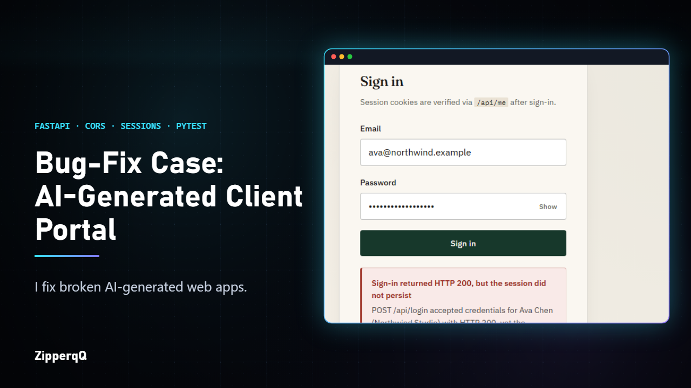
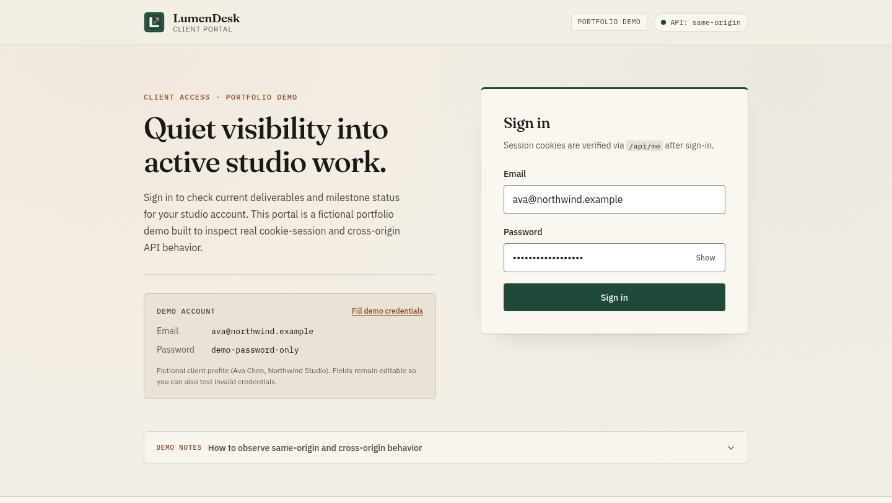
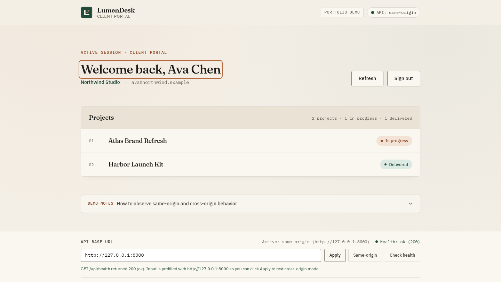

# LumenDesk Client Portal — Bug Fix Case



LumenDesk is a fictional client portal with one demo account and two sample projects. The fixed demo supports sign-in, session restore on reload, and sign-out from both the API-served page and a separate local preview.

This repository is a before/after case study of three bugs typical of AI-generated web apps: a CORS preflight that blocked cross-origin login, a session cookie scoped so tightly that a successful login still left the user signed out, and an environment variable typo (`CORS_ORIGIN` vs `CORS_ORIGINS`) that ignored the documented origin list. [CASE_STUDY.md](CASE_STUDY.md) explains the diagnosis and the fix. The pre-fix source is in [before/](before/). See also [bug notes](docs/BUGS.md).

## Screenshots

| Sign-in (demo account) | After the fix: session restored |
| --- | --- |
|  |  |

Sign in as `ava@northwind.example` with `demo-password-only`. Those credentials are fictional and documented in the UI.

## Tech stack

- **Python 3.12+** with FastAPI, Uvicorn, Pydantic, itsdangerous, httpx, and python-dotenv
- Vanilla HTML, CSS, and JavaScript frontend
- Cookie-based sessions and explicit CORS origins
- Pytest regression suite (8 tests) covering the repaired login, session, and configuration behavior

## Start the API

Use Python 3.12. From the repository root, create the virtual environment and install the dependencies once.

**Windows (PowerShell):**

```powershell
python -m venv .venv
.\.venv\Scripts\python.exe -m pip install -r requirements.txt
```

```powershell
$env:SESSION_SECRET = & .\.venv\Scripts\python.exe -c 'import secrets; print(secrets.token_urlsafe(32))'
$env:DEMO_USER_PASSWORD = 'demo-password-only'
.\.venv\Scripts\python.exe -m app
```

**macOS / Linux:**

```bash
python3 -m venv .venv
.venv/bin/python -m pip install -r requirements.txt
export SESSION_SECRET="$(.venv/bin/python -c 'import secrets; print(secrets.token_urlsafe(32))')"
export DEMO_USER_PASSWORD='demo-password-only'
.venv/bin/python -m app
```

The defaults are `APP_HOST=127.0.0.1`, `APP_PORT=8000`, and a `CORS_ORIGINS` list covering `127.0.0.1` and `localhost` on both ports 8000 and 5500. Provide comma-separated explicit origins in `CORS_ORIGINS` to replace that list. `SESSION_SECRET` and `DEMO_USER_PASSWORD` are required. You can store settings in a local, ignored `.env` using [.env.example](.env.example) as a reference. Process environment values take precedence. Reuse the same signing key across restarts to keep existing sessions valid.

## Open the portal

**Same origin on port 8000.** Open <http://127.0.0.1:8000/> and leave the API in **Same-origin** mode.

**Cross-origin preview on port 5500.** Keep the API running. In a second terminal at the repository root, serve the existing frontend.

```powershell
.\.venv\Scripts\python.exe -m http.server 5500 --bind 127.0.0.1 --directory frontend
```

```bash
.venv/bin/python -m http.server 5500 --bind 127.0.0.1 --directory frontend
```

| Preview URL with API preset | API target |
| --- | --- |
| [127.0.0.1 preview](http://127.0.0.1:5500/?api=http://127.0.0.1:8000) | `http://127.0.0.1:8000` |
| [localhost preview](http://localhost:5500/?api=http://localhost:8000) | `http://localhost:8000` |

You can also enter the API target in the footer's **API Base URL** field and click **Apply**. Keep the hostname the same on both ports so the browser treats the preview and API as the same site for the session cookie.

In either mode, sign in as `ava@northwind.example` with `demo-password-only`. Ava Chen's profile and two projects should appear. Reload to verify the session persists, then click **Sign out**. If you configured a different demo password, enter it in the form.

## API routes

Open `/docs` on port 8000 for the interactive API reference.

| Method | Route | Purpose |
| --- | --- | --- |
| GET | `/api/health` | Check that the API is running |
| POST | `/api/login` | Sign in with `email` and `password` |
| POST | `/api/logout` | Sign out |
| GET | `/api/me` | Read the signed-in user's profile |
| GET | `/api/projects` | List the signed-in user's projects |

## Run tests offline

After installing dependencies, run from the repository root. The tests exercise the app in process without running either server or requiring a local `.env`.

```powershell
.\.venv\Scripts\python.exe -m pytest -q
```

```bash
.venv/bin/python -m pytest -q
```

The tests cover credentialed preview requests on both hostnames, the login and logout flow, and the documented configuration settings. Follow the commands in [CASE_STUDY.md](CASE_STUDY.md) to reproduce the original failures alongside the fixed behavior.

To compare the original API with the fix, start the app from `before/` instead of the repository root, as shown in the case study.

## License

[MIT](LICENSE)
